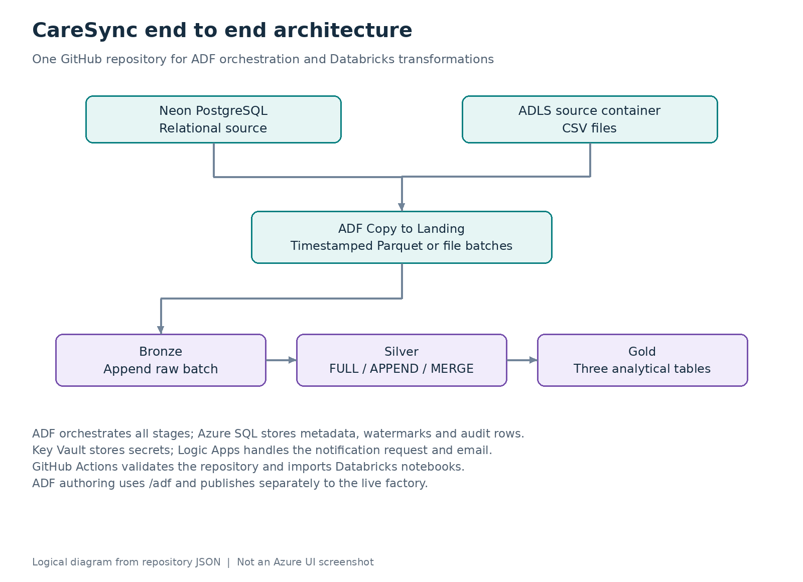

# CareSync

## End to End Azure Data Engineering Project

**Azure Data Factory · Azure Databricks · ADLS Gen2 · Azure SQL · GitHub Actions · Logic Apps · Key Vault**

CareSync is a batch healthcare data engineering project that ingests data from Neon PostgreSQL and CSV files in Azure Data Lake Storage, processes it through Landing, Bronze, Silver and Gold layers, and produces three analytical tables. Azure Data Factory orchestrates the workflow, Azure SQL stores configuration and execution metadata, and Logic Apps receives an email notification request.

This monorepo combines the ADF resources from [health_project_repo](https://github.com/theng23/health_project_repo) and the Databricks notebooks from [caresync-adb-repo](https://github.com/theng23/caresync-adb-repo). Both platforms can use the same GitHub repository while consuming separate folders.

**Scope:** five operational ADF pipeline definitions, six deployable notebooks including a calendar setup notebook, three Gold outputs, local validation and a Databricks deployment workflow. Azure resource provisioning, source-data exports, the original control-database contents and the deployed Logic Apps workflow are not included. Set up the environment before running the project.

**Read in Vietnamese:** [Project guide](docs/guide.vi.md). Start with [deployment](docs/deployment.md) to run the project or [migration](docs/migration.md) to move from the two original repositories.

## Contents

- [Architecture](#architecture)
- [End to end data flow](#end-to-end-data-flow)
- [Five ADF pipelines](#five-adf-pipelines)
- [Medallion layers and Gold outputs](#medallion-layers-and-gold-outputs)
- [Repository structure](#repository-structure)
- [Getting started](#getting-started)
- [CI and CD](#ci-and-cd)
- [Observability and notifications](#observability-and-notifications)
- [Pipeline screenshots](#pipeline-screenshots)
- [Current limitations](#current-limitations)

## Architecture



| Component | Responsibility |
| --- | --- |
| Neon PostgreSQL | Relational source queried by the PostgreSQL V2 connector |
| ADLS Gen2 | CSV source files and timestamped Landing batches |
| Azure Data Factory | Scheduling, metadata lookups, Copy activities and notebook orchestration |
| Azure Databricks | Landing to Bronze, Bronze to Silver, calendar creation and Gold transformations |
| Azure SQL Database | `ctrl.table_config`, `ctrl.watermark` and `ctrl.audit_log` |
| Azure Key Vault | Source credentials, the ADF Databricks token and the Logic Apps callback URL |
| Azure Logic Apps | HTTP notification endpoint and configured email connector |
| GitHub Actions | Repository validation and Databricks notebook deployment |

## End to end data flow

1. `TGR_CARESYNC_DAILY` invokes `PL_MASTER`. Despite its name, the supplied recurrence is **every eight hours**, using `SE Asia Standard Time` (UTC+7). The packaged trigger starts stopped.
2. `PL_MASTER` starts the PostgreSQL and CSV source branches in parallel. It passes its own `RunId` to every child pipeline as `adf_run_id`.
3. `PL_SOURCE_TO_SILVER_MAIN` reads active `SOURCE_TO_SILVER` entries for its `source_system`, inserts `IN_PROGRESS` audit rows and invokes one inner pipeline per table in a parallel `ForEach`.
4. `PL_SOURCE_TO_SILVER_INNER` reads table configuration and the prior watermark when required. PostgreSQL rows are copied to Parquet; CSV files are copied as binary files into a timestamped Landing folder.
5. `Landing_to_Bronze` reads that batch and appends it to a Bronze table with load metadata. `Bronze_to_Silver` processes the same batch using `FULL`, `APPEND` or `MERGE` according to metadata.
6. After both source branches succeed, `PL_SILVER_TO_GOLD` runs the configured Gold notebooks in parallel. The three supplied Gold notebooks fully rebuild their output tables.
7. After Gold succeeds, `PL_SEND_EMAIL` reads the audit rows, prepares a summary, retrieves the Logic Apps callback URL from Key Vault and sends an HTTP POST. Logic Apps handles email delivery.

The master currently invokes notifications through a **success dependency**. It does not guarantee an email for a failed source or Gold run. See [current limitations](#current-limitations).

## Five ADF pipelines

The following images are **logical diagrams reconstructed from the pipeline JSON in this monorepo**. They are not screenshots or evidence of a successful cloud run. Expanded activity descriptions and parameter contracts are in [the pipeline reference](docs/pipelines.md).

| Pipeline | Input parameters | Main responsibility |
| --- | --- | --- |
| `PL_MASTER` | None | Coordinate both source branches, Gold processing and notification |
| `PL_SOURCE_TO_SILVER_MAIN` | `source_system`, `adf_run_id` | Select active tables, create audit rows and orchestrate per-table ingestion |
| `PL_SOURCE_TO_SILVER_INNER` | `table_id`, `adf_run_id` | Copy a source batch, call Bronze and Silver notebooks, update status and watermark |
| `PL_SILVER_TO_GOLD` | `adf_run_id` | Select Gold metadata, execute Gold notebooks and record results |
| `PL_SEND_EMAIL` | `adf_run_id` | Summarize audit records and call Logic Apps |

### 1 PL_MASTER


The two source branches have no dependency on each other. Gold waits for **both** to succeed; the notification waits for Gold to succeed.

### 2 PL_SOURCE_TO_SILVER_MAIN


The table list comes from Azure SQL metadata. Each loop iteration creates an audit record before calling the inner pipeline. A failed inner execution has explicit failure logging and a Fail activity.

### 3 PL_SOURCE_TO_SILVER_INNER


The source-system switch supports `neon_postgres` and `adls_csv`. Both branches converge on the same Bronze and Silver notebooks. For incremental loads, the existing implementation updates the watermark after Silver succeeds.

### 4 PL_SILVER_TO_GOLD


The notebook path is constructed from `gold_table_name`, so values such as `patient_360` resolve to `Gold/NB_patient_360`. The notebook returns a row count that is written to `ctrl.audit_log`.

### 5 PL_SEND_EMAIL


Audit status queries use the master run ID. The callback URL is fetched at runtime with the ADF managed identity and is excluded from committed factory parameters. See the [Logic Apps contract](docs/logic-apps.md).

## Medallion layers and Gold outputs

| Layer | Location | Behaviour |
| --- | --- | --- |
| Source | PostgreSQL `public` tables; ADLS `source` container | Operational input data and CSV files |
| Landing | `landing/<source_system>/<source_table_name>/<timestamp>/` | Batch-level raw files; Parquet for PostgreSQL and copied files for CSV |
| Bronze | `adb_healthy.bronze.<table>` | Appends the batch; adds `landing_timestamp` and `insert_timestamp` |
| Silver | `adb_healthy.silver.<table>` | Applies the configured write strategy and load timestamps |
| Gold | `adb_healthy.gold.<table>` | Full table rebuilds for the supplied analytical models |

The current Silver notebook applies load strategies and metadata columns. It does not implement a general cleansing, masking or data-quality framework.

| Gold table | Grain | Inputs | Example outputs |
| --- | --- | --- | --- |
| `patient_360` | One row per patient, assuming unique patient and dimension keys | Patients, hospitals, insurance providers, lab results | Patient attributes, hospital and insurer names, test counts and last test date |
| `hospital_daily_summary` | One row per hospital and date with lab activity | Lab results, hospitals, calendar | Test volumes, unique patients, abnormal and critical counts and volume changes |
| `lab_test_trends` | One row per test name, year and month with lab activity | Lab results, calendar | Monthly test counts, abnormal and critical rates and rate changes |

All three Gold notebooks deduplicate lab results by `lab_result_id`, keeping the row with the latest `update_timestamp`. Equal timestamps have no additional tie-breaker. The hospital `LAG` compares the previous observed activity date; the monthly `LAG` compares the previous observed month. Missing periods are not filled.

The original [Silver to Gold mapping workbook](docs/data-model/sttm_silver_to_gold.xlsx) is retained. SQL in the notebooks defines the current executable transformations.

## Repository structure

| Path | Contents |
| --- | --- |
| `adf/` | Five pipelines, four datasets, five linked services, factory parameters, schedule and publish configuration |
| `databricks/notebooks/` | Two ingestion notebooks, three Gold notebooks and one calendar setup notebook |
| `.github/workflows/` | Local CI validation and Databricks workspace deployment |
| `config/` | Non-secret environment example; ignored local configuration |
| `sql/control/` | New-install control-table bootstrap, disabled example metadata and audit queries |
| `sql/databricks/` | Unity Catalog setup template and Gold quality checks |
| `docs/` | Architecture, five pipeline diagrams, setup, migration, operations and Vietnamese guide |
| `tools/` | Environment configuration, local validation and diagram generation |
| `archive/` | Experimental notebooks, the incomplete test pipeline, unrelated SQL and original README files |

No nested `.git` directories are included. Archived files are outside the ADF root and Databricks deployment source.

## Getting started

1. Make this folder the root of one GitHub repository. Follow [the migration guide](docs/migration.md); the ZIP is a combined working tree, without merged commit history.
2. Prepare ADF, ADLS Gen2, Azure SQL, Key Vault, a Unity Catalog enabled Databricks workspace and cluster, PostgreSQL and a Logic Apps email workflow.
3. Create the `source` and `landing` storage containers and configure the Unity Catalog external location and Landing volume. The notebook expects `/Volumes/adb_healthy/landing/landing_volumne`.
4. Keep your existing control tables if already configured. For a new installation, review `sql/control/01_create_control_tables.sql`, then adapt `02_seed_metadata_example.sql`. Its source assignments are illustrative and **all entries start disabled**.
5. Copy `config/environment.example.json` to `config/environment.local.json`, fill every value, and run:

   ```bash
   python tools/configure_environment.py --config config/environment.local.json
   python tools/validate_repo.py
   ```

6. Create the Key Vault secrets and permissions described in [deployment](docs/deployment.md). Do not put passwords, tokens or signed callback URLs into Git.
7. Configure the ADF Git root as **`/adf`**, collaboration branch `main`, and publish branch `adf_publish`. Deploy notebooks to **`/Shared/caresync/databricks`** or another absolute path that matches `databricks_notebook_root`.
8. Run `setup/Calendar_Dimension_Build` once, confirm source schemas and metadata, then activate the intended control rows. Validate and publish ADF changes.
9. Run `PL_MASTER` manually. Inspect audit records, Gold tables and the Logic Apps run. Enable the eight-hour trigger after the smoke run succeeds.

See [deployment](docs/deployment.md) for the complete sequence and [operations](docs/operations.md) for success checks and reruns.

## CI and CD

One repository supports two deployment paths:

| Change | Validation | Deployment |
| --- | --- | --- |
| ADF authoring JSON | `tools/validate_repo.py` and ADF Validate All | ADF Publish All from `main`; generated templates go to `adf_publish` |
| Databricks notebooks | Local reference, widget and Python syntax checks | GitHub Actions imports `databricks/notebooks` into the configured workspace folder |

The Databricks workflow deploys to the GitHub `dev` environment after matching pushes to `main`. Manual dispatch can select `dev` or `prod`. Configure `DATABRICKS_HOST` and `DATABRICKS_WORKSPACE_ROOT` as environment variables and `DATABRICKS_TOKEN` as an environment secret. Set production environment protection rules before using `prod`.

`import-dir --overwrite` updates existing notebook paths and strips notebook filename extensions. It does not run notebooks, provision compute or remove stale workspace notebooks. The action uses `databricks/setup-cli@main`; pin a tested action revision and CLI version when adopting a release policy.

The package provides Databricks CD and ADF Git authoring/publishing. It does not provide an automated ADF multi-environment ARM deployment or infrastructure provisioning workflow. The supplied original repositories contained no GitHub Actions workflow files; the workflows here are new additions.

## Observability and notifications

- `ctrl.table_config` determines active tables, source systems, target names, write strategy and Gold notebook selection.
- `ctrl.watermark` stores incremental boundaries per source table.
- `ctrl.audit_log` records the master run ID, table ID, stage, status, times and returned record count.
- Notebooks return row counts through `dbutils.notebook.exit`; these counts represent the batch processed or the rebuilt Gold table, not a verified net insert count.
- The notification subject uses the environment and whether audit rows for that run contain a non-`SUCCESS` status. Zero audit rows can still yield a `SUCCESS` subject, so verify the expected table count.

## Pipeline screenshots

Use the diagrams above immediately. For actual ADF canvas images, follow [the screenshot guide](docs/screenshots/README.md) and add five PNG files under `docs/screenshots/`. It includes the exact filenames and Markdown snippets for each pipeline. Keep run-result screenshots separate from design screenshots.

## Current limitations

| Area | Current behaviour and consequence |
| --- | --- |
| Failure emails | `PL_SEND_EMAIL` is reached only after successful Gold processing in the master graph. Add and test explicit failure notification paths before relying on alerts. |
| Watermark safety | PostgreSQL extraction uses `watermark_column > prior watermark`; the next watermark is set to `SYSUTCDATETIME()` after processing. There is no fixed upper extraction boundary, so rows arriving during the run can be missed. |
| Empty batches | The Landing notebook exits with a message when a folder is missing; downstream Silver may still run and FULL mode can overwrite a table with an empty batch. Add an explicit no-data branch before unattended production use. |
| Replays | Bronze is append-only. Replaying a batch can duplicate Bronze data; APPEND can also duplicate Silver data. MERGE requires valid, unique source keys. |
| Naming | Existing notebooks assume matching source, Bronze and Silver table names and the fixed catalog `adb_healthy`. The Landing volume spelling `landing_volumne` is intentional compatibility. |
| Gold semantics | Age is approximate; missing dates/months are not filled; joined dimensions must have unique keys. Gold rebuilds are not incremental. |
| Audit recovery | Status updates are not transactional with Delta writes or watermark updates. Reconcile audit and watermark state after a partial failure. Avoid overlapping master runs against the same tables. |
| Runtime evidence | Local validation does not execute Azure services, Spark transformations, source SQL or email delivery. No new cloud run is asserted by this package. |

[Migration notes](docs/migration.md) list the changes made while combining the repositories.

## References

- [ADF source control and publishing](https://learn.microsoft.com/en-us/azure/data-factory/source-control)
- [Databricks workspace CLI commands](https://learn.microsoft.com/en-us/azure/databricks/dev-tools/cli/reference/workspace-commands)
- [Databricks CLI GitHub Action](https://github.com/databricks/setup-cli)
- [ADF access to Key Vault secrets](https://learn.microsoft.com/en-us/azure/data-factory/how-to-use-azure-key-vault-secrets-pipeline-activities)

## License

The supplied repositories did not include a license. Choose and add a license before granting reuse rights for a public release.
