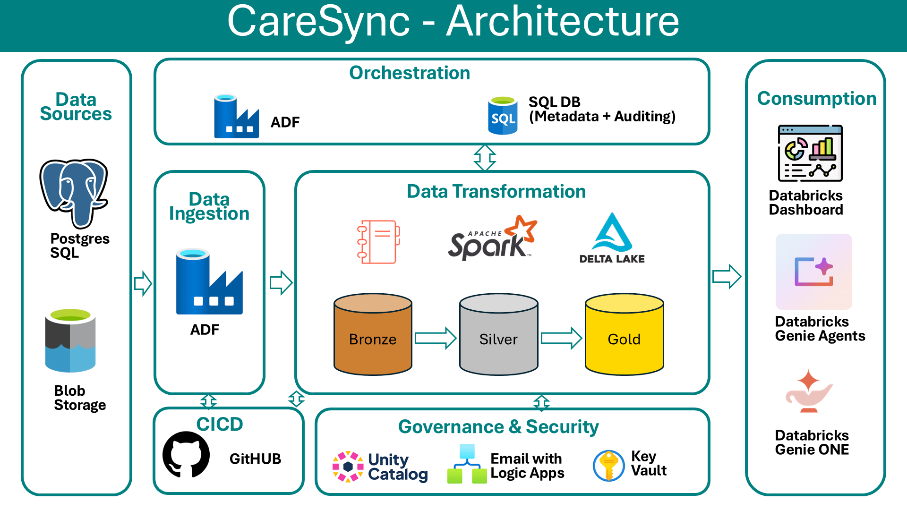
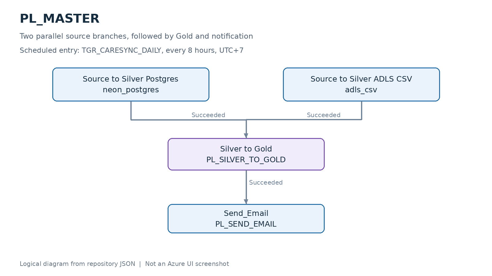
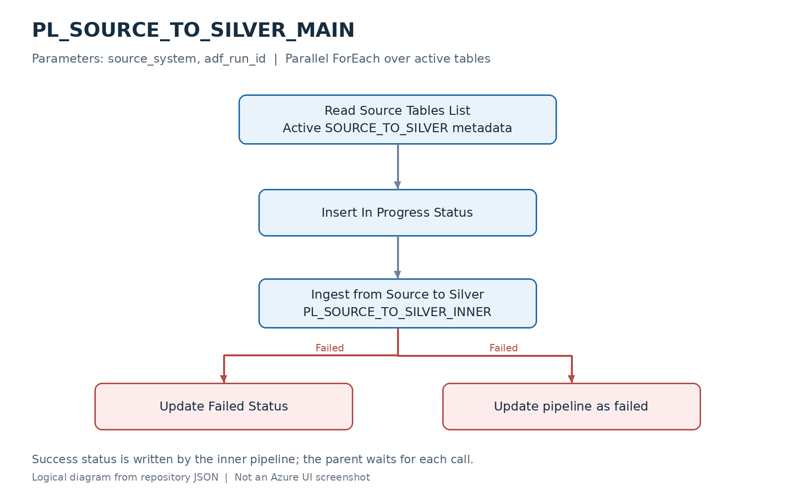
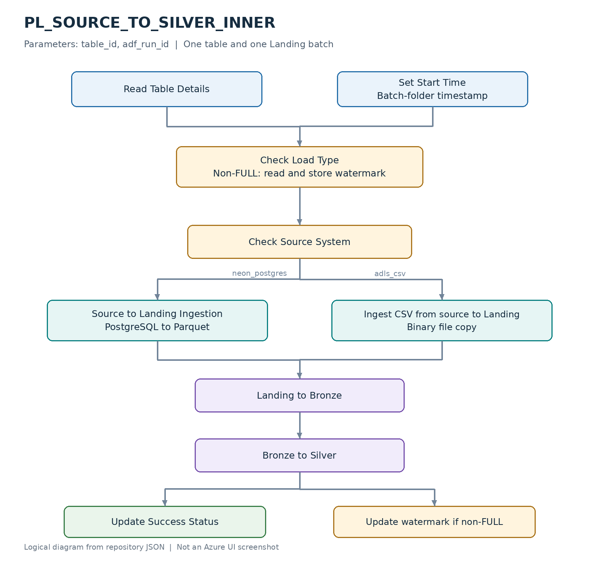
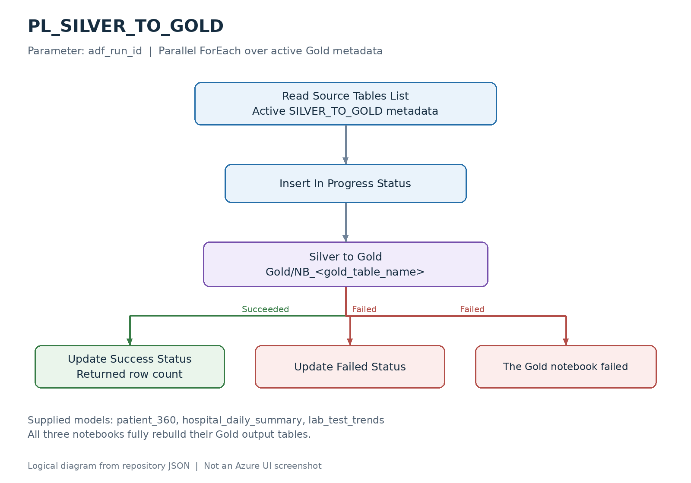
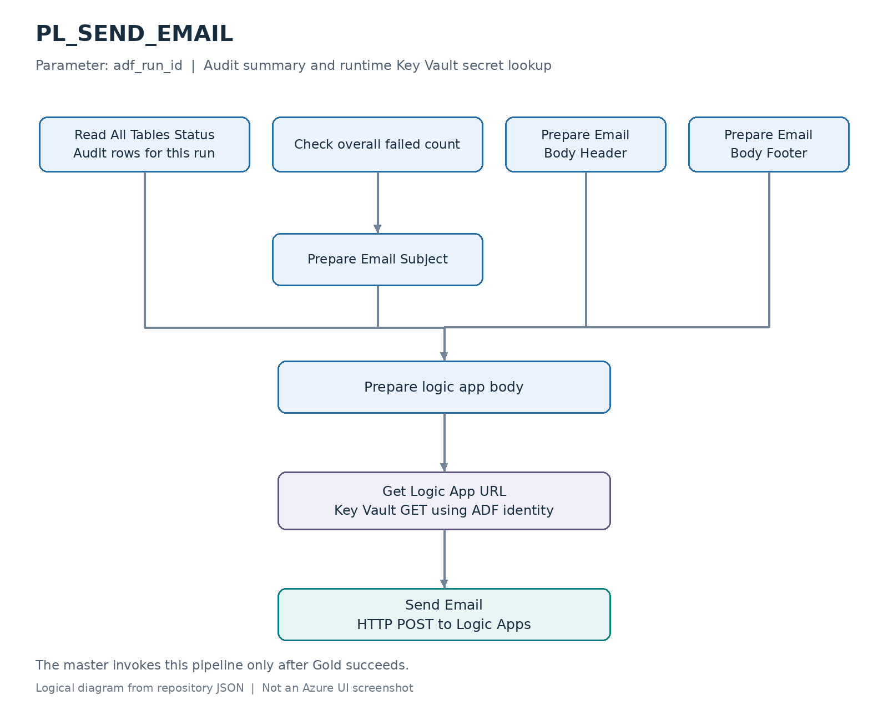

# End-to-End Azure Healthcare Data Engineering Project

**Azure Data Factory · Azure Databricks · ADLS Gen2 · Azure SQL · GitHub Actions · Logic Apps · Key Vault**

This project models a healthcare reporting workload in which patient, hospital, insurance-provider and laboratory data are distributed across PostgreSQL tables and CSV files. It builds a repeatable batch pipeline that brings these sources into a lakehouse and publishes three analytical tables for operational reporting.

The goal is to give business and analytics teams a shared reporting foundation, while giving engineering teams visibility into which tables were processed, when they ran and how many records they produced.

## Contents

- [Business problem](#business-problem)
- [Project objectives](#project-objectives)
- [Stakeholders and deliverables](#stakeholders-and-deliverables)
- [Architecture and technology trade-offs](#architecture-and-technology-trade-offs)
- [End-to-end data flow](#end-to-end-data-flow)
- [Five ADF pipelines](#five-adf-pipelines)
- [Data layers and analytical models](#data-layers-and-analytical-models)
- [Repository structure](#repository-structure)
- [Getting started](#getting-started)
- [CI/CD](#cicd)
- [Observability and validation](#observability-and-validation)
- [Current limitations and next steps](#current-limitations-and-next-steps)

## Business problem

In this reporting scenario, patient registration, hospital information, insurance-provider reference data and laboratory results are maintained in different sources. Reporting requires these records to be combined before teams can answer questions such as:

- Which hospitals have the highest recorded laboratory workload, and how does that workload change over time?
- How many patients and doctors are represented in each hospital's daily test activity?
- How do the recorded abnormal and critical result rates vary by test type and month?
- What hospital, insurer and laboratory activity are associated with a patient?
- Which source tables completed the latest data refresh, and which require investigation?

Without a shared processing workflow, each reporting task can require its own extracts, joins and reconciliation. Definitions can diverge between reports, and incomplete refreshes can be difficult to trace.

This project addresses that integration and reporting problem by separating raw ingestion, table loading and analytical transformations, with configuration and audit records maintained alongside the data flow.

## Project objectives

| Objective | Implemented approach | Intended business or operational value |
| --- | --- | --- |
| Integrate relational and file-based data | ADF copies PostgreSQL records and ADLS CSV files into timestamped Landing batches | Give reporting teams a common entry point for the supported sources |
| Reuse ingestion logic across tables | Azure SQL metadata selects active tables, source systems and loading strategies | Add compatible tables through configuration instead of duplicating a pipeline for every table |
| Keep processing stages inspectable | Landing files and Bronze, Silver and Gold tables separate ingestion from reporting transformations | Make it easier to inspect inputs and investigate discrepancies between stages |
| Publish defined analytical outputs | Three Gold models with explicit grains and metric definitions | Provide a consistent foundation for hospital, patient and laboratory reporting |
| Trace each refresh | A master run ID links per-table status, timestamps and returned record counts | Help data operations identify incomplete processing and reconcile the expected tables |
| Manage code and credentials separately | GitHub validation and notebook deployment; secrets read from Key Vault or GitHub environment secrets | Make code changes repeatable while keeping credential values outside committed project configuration |

Success should be assessed through source reconciliation, output-grain checks, refresh completion and the effort needed to investigate data issues. Any reduction in manual work or processing cost needs to be measured in the deployment environment.

## Stakeholders and deliverables

| Stakeholder | What the project provides | How it can be used |
| --- | --- | --- |
| Hospital operations managers | `hospital_daily_summary`: test counts, unique patients, distinct doctors, recorded abnormal and critical counts, and volume changes | Compare observed workload across hospitals and dates, and provide evidence for capacity and staffing discussions |
| Laboratory quality and reporting teams | `lab_test_trends`: monthly test volumes, abnormal and critical rates, and changes in abnormal rates | Review changes in recorded result categories and identify patterns for further investigation |
| Patient services and reporting analysts | `patient_360`: patient attributes joined with hospital, insurance-provider and laboratory summaries | Build patient-level reporting without repeating the same joins in every extract |
| Business managers | Three Gold tables with documented grains, calculations and refresh audit records | Establish a shared basis for operational reports and check whether the expected refresh completed |
| BI and analytics developers | Queryable Gold tables and a calendar dimension | Build downstream dashboards, reporting datasets or additional analyses |
| Data engineering and platform teams | Configurable ingestion, stored watermarks, per-table audit records, validation and notebook deployment workflows | Operate the data pipeline, inspect failures and manage code changes |

**Delivered scope:** five operational ADF pipelines, six deployable notebooks including calendar setup, three Gold tables, control-table examples, validation scripts, notebook deployment workflows and pipeline design diagrams.

The repository supplies the data-processing foundation. Downstream dashboards, financial models and measured business outcomes are extensions to that foundation. Azure resources, source data, environment metadata and the Logic Apps email connector must be configured before execution.

## Architecture and technology trade-offs
### Overall Architecture


### Platform choices

The choices below reflect this project's batch workload and implementation. The trade-offs are engineering assessments; actual cost and performance depend on data volume, refresh frequency, permissions and compute configuration.

| Technology | Why it is used here | Trade-off |
| --- | --- | --- |
| **Azure Data Factory** | Provides Copy activities, scheduling, metadata lookups, branching and notebook orchestration across PostgreSQL, ADLS and Databricks | Pipeline state and Spark execution are inspected in different services. For a workload entirely within Databricks, native job orchestration could reduce the number of orchestration systems |
| **Azure Databricks and Delta tables** | Runs reusable PySpark ingestion and Spark SQL analytical transformations; supports the Silver `MERGE` strategy | Adds compute and runtime-management overhead. Small, SQL-only workloads may need a simpler processing design; this implementation has not been benchmarked against one |
| **ADLS Gen2** | Stores source files and timestamped Landing batches, with the Landing container exposed through a Unity Catalog volume | Retaining raw files and multiple processing layers increases storage and retention-management work |
| **Azure SQL Database** | Stores queryable table configuration, watermarks and audit rows independently of the notebooks | Adds a database dependency. SQL control updates and Delta writes do not share one transaction, so partial failures need reconciliation |
| **Neon PostgreSQL** | Provides the external relational source alongside the file-based source | External-source networking, connectivity and data-transfer considerations remain part of operations; moving sources into the same cloud would change those constraints |
| **GitHub Actions** | Validates project references and deploys notebooks from version-controlled source | Deployment requires environment variables, secrets and workspace permissions. Notebook import does not execute transformations or deploy ADF automatically |
| **Azure Key Vault** | Stores source passwords, the ADF Databricks token and the Logic Apps callback URL outside committed configuration | Secret access depends on identity permissions, network access and secret lifecycle management |
| **Azure Logic Apps** | Separates the HTTP notification request and email integration from data transformation code | Adds a workflow and email-connector dependency. A successful data write does not guarantee email delivery, and the current master does not invoke notification for every failure path |

### Processing decisions

| Decision | Benefit | Accepted limitation |
| --- | --- | --- |
| Scheduled batch processing | Matches periodic operational reporting and provides a bounded run to inspect | The configured cadence is every eight hours, with processing time added; the pipeline does not provide real-time freshness |
| Landing plus Bronze, Silver and Gold | Preserves batch inputs and separates loading from analytical logic | More persisted stages require additional storage, access rules and maintenance |
| `FULL`, `APPEND` and `MERGE` at Silver | Allows a table-specific write strategy | FULL can overwrite data, APPEND can create duplicates on replay, and MERGE depends on valid, unique source keys |
| Full Gold rebuilds | Keeps the three analytical SQL transformations straightforward | Every Gold run rereads its inputs and rewrites its output; incremental Gold processing may become necessary as data grows |
| Watermark-based extraction | Supports incremental source selection using a stored boundary | The current implementation needs a fixed upper extraction boundary and late-arrival handling before it can provide reliable unattended incremental processing |

## End-to-end data flow

1. **Schedule:** `TGR_CARESYNC_DAILY` starts `PL_MASTER`. Its configured recurrence is every eight hours in `SE Asia Standard Time` (UTC+7). The distributed trigger definition is stopped until the environment is validated.
2. **Select tables:** the master starts `neon_postgres` and `adls_csv` branches in parallel. Each branch reads active `SOURCE_TO_SILVER` entries from `ctrl.table_config`.
3. **Create a batch:** the inner pipeline reads the table configuration and prior watermark when required. PostgreSQL records are copied to Parquet; CSV files are copied as binary files into timestamped Landing folders.
4. **Load Bronze:** `Landing_to_Bronze` reads the batch and appends it with `landing_timestamp` and `insert_timestamp` metadata.
5. **Load Silver:** `Bronze_to_Silver` processes the batch with `FULL`, `APPEND` or `MERGE`, according to the table configuration.
6. **Build Gold:** after both source branches succeed, `PL_SILVER_TO_GOLD` selects active Gold metadata and runs the configured analytical notebooks in parallel.
7. **Record and notify:** pipeline activities record status and returned row counts in Azure SQL. After Gold succeeds, `PL_SEND_EMAIL` retrieves the callback URL from Key Vault and posts an audit summary to Logic Apps.

The master passes its `RunId` to child pipelines as `adf_run_id`, linking their audit records. The current notification call has a success dependency on Gold; source or Gold failures can skip the email pipeline.

## Five ADF pipelines

These images show the logical pipeline designs represented by the JSON definitions. Activity details and parameter contracts are documented in the [pipeline reference](docs/pipelines.md).

| Pipeline | Parameters | Responsibility |
| --- | --- | --- |
| `PL_MASTER` | None | Coordinate both source branches, Gold processing and notification |
| `PL_SOURCE_TO_SILVER_MAIN` | `source_system`, `adf_run_id` | Select active source tables, create audit entries and invoke per-table ingestion |
| `PL_SOURCE_TO_SILVER_INNER` | `table_id`, `adf_run_id` | Copy a batch, execute Bronze and Silver notebooks, and update status and watermark |
| `PL_SILVER_TO_GOLD` | `adf_run_id` | Execute configured Gold notebooks and record results |
| `PL_SEND_EMAIL` | `adf_run_id` | Prepare an audit summary and call Logic Apps |

### 1 PL_MASTER



PostgreSQL and CSV ingestion run independently. Gold waits for both source branches to succeed, and notification waits for Gold to succeed.

### 2 PL_SOURCE_TO_SILVER_MAIN



A metadata lookup supplies the active table list. Each parallel `ForEach` iteration creates an `IN_PROGRESS` audit row before invoking the inner pipeline. Failed inner executions have failure logging and an explicit Fail activity.

### 3 PL_SOURCE_TO_SILVER_INNER



The source-system switch selects PostgreSQL or CSV ingestion. Both paths converge on the same Bronze and Silver notebooks. For non-FULL loads, the watermark update runs after Silver succeeds.

### 4 PL_SILVER_TO_GOLD



The notebook path is built from `gold_table_name`. For example, `patient_360` selects `Gold/NB_patient_360`. Each notebook returns the rebuilt table's row count for the audit record.

### 5 PL_SEND_EMAIL



The pipeline queries audit rows for the master run ID, prepares the subject and body, retrieves the callback URL using the ADF managed identity and sends the HTTP request. See the [Logic Apps contract](docs/logic-apps.md).

Actual ADF canvas captures can be added using the [screenshot instructions](docs/screenshots/README.md). The diagrams above describe configuration rather than the result of a cloud execution.

## Data layers and analytical models

### Storage and processing layers

| Layer | Location | Current behaviour |
| --- | --- | --- |
| Source | PostgreSQL `public` tables and ADLS `source` container | Operational input records and CSV files |
| Landing | `landing/<source_system>/<source_table_name>/<timestamp>/` | Batch-level files: Parquet for PostgreSQL and copied files for CSV |
| Bronze | `adb_healthy.bronze.<table>` | Appends the batch and load metadata |
| Silver | `adb_healthy.silver.<table>` | Applies the configured write strategy and load timestamps |
| Gold | `adb_healthy.gold.<table>` | Rebuilds the analytical outputs with Spark SQL |

Silver currently implements loading strategies and audit columns. Broader cleansing rules, schema enforcement and data-quality policies are future enhancements.

### Gold data products

| Table | Grain | Main measures or attributes |
| --- | --- | --- |
| `patient_360` | One row per patient, assuming unique patient and dimension keys | Patient demographics, hospital and insurance-provider names, total tests, abnormal and critical counts, and last test date |
| `hospital_daily_summary` | One row per hospital and date with laboratory activity | Test volume, unique patients, distinct doctors, abnormal and critical counts and rates, and volume change from the previous observed activity date |
| `lab_test_trends` | One row per test name, year and month with laboratory activity | Monthly test counts, abnormal and critical rates, and abnormal-rate change from the previous observed month |

All three Gold notebooks deduplicate laboratory records by `lab_result_id`, selecting the latest `update_timestamp`. Equal timestamps have no additional tie-breaker. Hospital and insurer dimension keys must also be unique to preserve the intended grain.

The daily and monthly `LAG` calculations compare consecutive observed periods. Dates or months with no activity are not filled automatically. Result rates use the source categories `Abnormal` and `Critical`; the patient age calculation is approximate.

Column mappings are available in the [Silver-to-Gold mapping workbook](docs/data-model/sttm_silver_to_gold.xlsx). The notebook SQL defines the executable calculations.

## Repository structure

| Path | Contents |
| --- | --- |
| `adf/` | Pipelines, datasets, linked services, factory parameters, trigger and publish configuration |
| `databricks/notebooks/` | Bronze and Silver ingestion, Gold transformations and calendar setup |
| `.github/workflows/` | Repository validation and Databricks notebook deployment |
| `config/` | Environment configuration example and ignored local configuration |
| `sql/control/` | Control-table bootstrap, example metadata and audit queries |
| `sql/databricks/` | Unity Catalog setup template and Gold quality checks |
| `docs/` | Architecture, data mappings, pipeline diagrams and deployment/operations references |
| `tools/` | Environment configuration, local validation and diagram generation |
| `archive/` | Experiments and reference files excluded from active deployment |

ADF uses `/adf` as its Git root. The notebook deployment workflow imports only `databricks/notebooks`.

## Getting started

1. Clone the repository and open its root directory:

   ```bash
   git clone https://github.com/theng23/End-to-End-Azure-Healthcare-Data-Engineering-Project.git
   cd End-to-End-Azure-Healthcare-Data-Engineering-Project
   ```

2. Prepare ADF, ADLS Gen2, Azure SQL, Key Vault, a Unity Catalog enabled Databricks workspace and cluster, PostgreSQL, and a Logic Apps HTTP-to-email workflow.
3. Create the `source` and `landing` containers. Configure the Unity Catalog external location and `/Volumes/adb_healthy/landing/landing_volumne` volume to expose the Landing container.
4. Configure `ctrl.table_config`, `ctrl.watermark` and `ctrl.audit_log`. For a new installation, review the scripts under `sql/control/`. The seed is illustrative and its entries remain disabled until their source mappings are verified.
5. Copy `config/environment.example.json` to `config/environment.local.json`, fill the environment values, and run:

   ```bash
   python tools/configure_environment.py --config config/environment.local.json
   python tools/validate_repo.py
   ```

6. Create the required Key Vault secrets and grant the execution identities the appropriate secret, storage, SQL and Databricks access.
7. Connect ADF to this repository with Git root `/adf`, collaboration branch `main` and publish branch `adf_publish`. Deploy notebooks to a workspace path matching the factory global `databricks_notebook_root`, such as `/Shared/caresync/databricks`.
8. Run `setup/Calendar_Dimension_Build` once. Verify source schemas and table metadata, then activate the intended configuration rows. Validate and publish ADF changes.
9. Run `PL_MASTER` manually. Check the expected audit entries, source reconciliation, Gold output grains and Logic Apps delivery before enabling the schedule.

See [deployment](docs/deployment.md) for resource permissions, secret names and setup details, and [operations](docs/operations.md) for validation and recovery procedures.

## CI/CD

| Asset | Validation | Deployment |
| --- | --- | --- |
| ADF authoring JSON | Local reference checks and ADF Validate All | ADF Publish All from `main`; generated ARM templates are written to `adf_publish` |
| Databricks notebooks | Reference, widget-contract and Python syntax checks | GitHub Actions imports `databricks/notebooks` into the target workspace folder |

The Databricks workflow deploys matching pushes on `main` to GitHub environment `dev`. Manual dispatch can select `dev` or `prod`. Configure:

| Setting | GitHub environment configuration |
| --- | --- |
| `DATABRICKS_HOST` | Variable containing the Databricks workspace URL |
| `DATABRICKS_WORKSPACE_ROOT` | Variable matching ADF `databricks_notebook_root` |
| `DATABRICKS_TOKEN` | Secret with permission to import notebooks into the target folder |

Configure production environment protection rules before using `prod`. The workflow validates and imports code; it does not run the data pipeline or provision compute. `import-dir --overwrite` updates matching paths but does not remove stale notebooks. The CLI setup action currently follows `databricks/setup-cli@main`; pin tested revisions and versions when establishing a release policy.

ADF publishing remains separate from notebook deployment. A Git commit does not publish the live factory. Automated ADF deployment across environments and infrastructure provisioning are future extensions.

## Observability and validation

### Control tables

- `ctrl.table_config` selects active tables, source systems, load strategies, target names and Gold notebooks.
- `ctrl.watermark` stores the source selection boundary for incremental loads.
- `ctrl.audit_log` records `adf_run_id`, table ID, stage, status, start/end times and returned row counts.

The returned count represents the processed Silver batch or rebuilt Gold table. It is not a separate measurement of net inserts. The email subject uses the environment and the count of non-`SUCCESS` audit rows; verify the expected audit-row inventory because an empty audit result can still produce a `SUCCESS` subject.

### Acceptance checks

| Check | Expected result |
| --- | --- |
| Configuration coverage | Both source systems and the intended Gold models have the expected active entries |
| Run traceability | Child audit entries share the master run ID and reach the appropriate terminal state |
| Source reconciliation | Known test inputs reconcile with the relevant Landing batch and Silver result under the selected write strategy |
| Gold grain | Patient, hospital/date and test/year/month uniqueness checks return no duplicate keys |
| Report readiness | Required tables and columns are available, with refresh completion visible to consumers |
| Notification | The Logic Apps request and configured email action complete for the tested success path |

Use `sql/control/03_check_execution.sql` with the actual master run ID and `sql/databricks/02_gold_quality_checks.sql` to inspect output grains and duplicate lab-result keys.

`tools/validate_repo.py` checks local references, dependency graphs, global parameters, notebook widgets, Python syntax and selected secret patterns. Runtime permissions, SQL behaviour, source data and email delivery must be verified through an environment smoke run.

## Current limitations and next steps

| Area | Current limitation | Next improvement |
| --- | --- | --- |
| Failure notifications | Source or Gold failures can skip `PL_SEND_EMAIL` | Add tested terminal-path notification handling that preserves the master failure status |
| Incremental boundaries | PostgreSQL reads rows above the prior watermark, then advances it to processing time without a fixed upper bound | Capture an upper boundary before extraction, process a defined window, and account for late arrivals |
| Empty batches | A missing Landing folder can exit with a message while Silver continues; FULL may overwrite with an empty batch | Add explicit no-data handling before writes |
| Replays and duplicate keys | Bronze and APPEND loads can duplicate data; MERGE needs unique source keys | Define replay policy and deterministic key-based deduplication |
| Cross-system recovery | Delta writes, SQL audit updates and watermark changes are not one transaction | Reconcile partial results and prevent overlapping runs against the same tables |
| Names and schemas | Notebooks use the fixed `adb_healthy` catalog and assume matching source, Bronze and Silver table names | Parameterize the remaining identifiers and enforce stable input schemas |
| Gold scaling | All three Gold models are fully rebuilt | Benchmark with representative volumes and introduce incremental models where justified |
| Consumption and access | Gold tables are the reporting endpoint of this implementation | Add stakeholder dashboards, suitable data access controls and retention rules for the deployment context |

## Technical references

- [Azure Data Factory Copy activity](https://learn.microsoft.com/en-us/azure/data-factory/copy-activity-overview)
- [Databricks medallion architecture](https://learn.microsoft.com/en-us/azure/databricks/lakehouse/medallion)
- [Databricks compute selection](https://learn.microsoft.com/en-us/azure/databricks/compute/choose-compute)
- [Databricks job scheduling considerations](https://learn.microsoft.com/en-us/azure/databricks/cheat-sheet/jobs)
- [Azure Logic Apps overview](https://learn.microsoft.com/en-us/azure/logic-apps/logic-apps-overview)
- [Using Key Vault secrets in ADF activities](https://learn.microsoft.com/en-us/azure/data-factory/how-to-use-azure-key-vault-secrets-pipeline-activities)
- [GitHub Actions secrets](https://docs.github.com/actions/security-guides/using-secrets-in-github-actions)
- [ADF source control and publishing](https://learn.microsoft.com/en-us/azure/data-factory/source-control)
- [Databricks workspace CLI commands](https://learn.microsoft.com/en-us/azure/databricks/dev-tools/cli/reference/workspace-commands)
